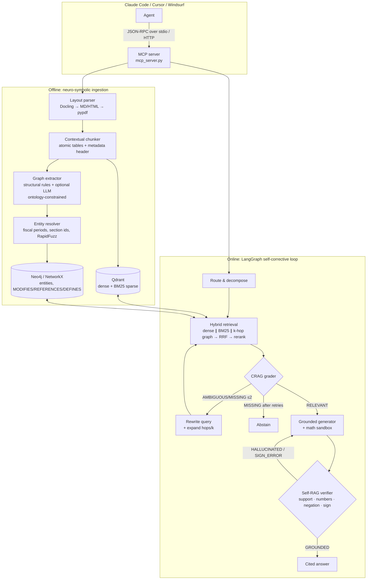

# Self-Corrective GraphRAG: an MCP server for document reading

**Layout-aware, graph-linked, self-verifying document retrieval for Claude Code, Cursor, Windsurf and any MCP client.**

Coding agents handle source code well but struggle with long reference documents: 300-page API specs, hardware datasheets, compliance manuals, 10-K filings. If an agent reads the PDF directly, it floods its context window, breaks tables apart, misses an override that sits 120 pages after the default it changes, and fills gaps with guesses. This server is built to fix each of those problems.

| What happens when an agent reads the PDF itself | What happens with `graphrag-reader` |
|---|---|
| Tens of thousands of raw tokens go into context, and facts in the middle get lost | About 5 verified chunks come back (roughly 800 tokens), with page citations |
| Multi-column pages get interleaved and table headers get cut off from their rows | Docling reads columns in the right order, tables stay whole, and units like "(in millions)" stay attached |
| A default in §2 and its override in Appendix B never show up together | A knowledge graph links them (`Appendix B -[MODIFIES]-> Section 2`), so both are retrieved |
| If the document is silent, the model guesses | Evidence is graded first (CRAG). If nothing supports an answer, the tool **abstains** |
| The model does arithmetic in its head and misreads `(0.3)` as positive | All math runs in a deterministic sandbox, and the verifier catches flipped signs and negations |

---

## Install in Claude Code

```bash
git clone https://github.com/<you>/self-corrective-graphrag && cd self-corrective-graphrag
uv sync                                   # core install (lite mode)
claude mcp add graphrag-reader -- uv run --directory "$PWD" mcp_server.py
```

> Use `--directory`: a plain `uv run /path/mcp_server.py` picks up the project from your *current* directory, not from where the script lives.
> Add `--scope project` to save the server to `.mcp.json` so your whole team gets it.

Then just ask:

> *"Ingest `docs/gateway-spec.pdf` and `docs/q3-compliance.pdf`, then update `config/rate_limits.py` to match the Enterprise rate-limit tables."*

Claude Code calls `ingest_complex_doc` once per file, then `ask_verified_docs` / `extract_verified_table` as it works.

**Cursor / Windsurf / Claude Desktop:** copy `.mcp.json.example` into the client's MCP config (`~/.cursor/mcp.json`, `~/.codeium/windsurf/mcp_config.json`, or `claude_desktop_config.json`) and fix the path.

**Remote / shared server:** `GRAPHRAG_TRANSPORT=streamable-http GRAPHRAG_PORT=8765 uv run mcp_server.py`, then connect with
`claude mcp add --transport http graphrag-reader http://host:8765/mcp`.

## Tools

| Tool | What it does |
|---|---|
| `ingest_complex_doc(file_path, domain_tag, doc_name?, force?)` | Parses the layout, splits the document into chunks with context, extracts entities and relations into the graph using a fixed ontology, and builds the dense and BM25 indexes. Running it again on an unchanged file does nothing. |
| `ask_verified_docs(query, doc_filter?, response_format?)` | Runs the full self-corrective loop and returns an answer with `[E#]` citations and a status: `verified`, `partially_verified` or `abstained`. |
| `trace_entity_relations(entity_name, max_hops, doc_filter?)` | Walks the graph out from a parameter, component, metric or section. Shows where it is defined, what references or overrides it, and cites every edge. |
| `extract_verified_table(topic, doc_name?, compute?)` | Returns the exact table as Markdown, with units and parenthetical negatives kept. Optional sandboxed arithmetic checks that every operand appears in the table. |
| `list_indexed_docs()` | Lists the indexed documents, the graph size, and which backends are active. |

## Architecture



### Design choices that matter

- **Cross-store foreign keys.** Each Qdrant payload stores `entity_ids`, and each graph node stores `chunk_ids`. That is how the graph leg and the vector leg feed into the same RRF ranking.
- **Graph seeds come from two places:** entities named in the query, and the section nodes of the top vector hits. So a question that never mentions "Enterprise" still reaches Appendix B's override through `Section 2 ←MODIFIES─ Appendix B`.
- **Override evidence is always included.** If a retrieved section is modified by another section, that modifying section is added to the evidence even when the reranker scored it low. Leaving out an override is the most damaging mistake a spec-QA system can make.
- **The ontology is fixed** per `domain_tag` (`technical`, `finance`, `legal`, `general`). Any LLM output with types outside it is dropped. Section IDs are scoped to their document, while parameters and metrics are shared, so documents link to each other through them.
- **Verification is mostly deterministic.** Every cited claim must overlap lexically with its source. Every number must appear in the cited chunk or come from the sandbox. A negation is checked against the best-matching source sentence. A `(x)` in the source shown as a positive value is flagged `SIGN_ERROR`. An internal LLM, if configured, adds a semantic check on top. It never replaces these checks.
- **The sandbox does not use `eval`.** It interprets an AST whitelist (numbers, operators, `pct_change`, `cagr`, `round`, …) with bounded exponents and magnitudes.

## Lite mode vs full mode

Every component works without its optional dependency and upgrades automatically once that dependency is installed:

| Component | Lite (default, zero setup) | Full |
|---|---|---|
| PDF parsing | pypdf (warns: no table structure) | `uv sync --extra docling` → Docling layout model |
| Dense embeddings | offline hashed n-gram embedder | `--extra embeddings` → fastembed `bge-small` (or set `GRAPHRAG_DENSE_MODEL=BAAI/bge-large-en-v1.5`) |
| Sparse | BM25 (Qdrant IDF modifier) | same |
| Reranker | lexical precision scorer | `--extra rerank` → `BAAI/bge-reranker-v2-m3` cross-encoder |
| Vector store | embedded Qdrant on disk | `docker compose up -d` + `QDRANT_URL` |
| Graph store | NetworkX + Louvain communities, saved as JSON | `NEO4J_URI` (Neo4j 5 / Memgraph) |
| LLM steps | deterministic: extractive answers, heuristic grading | `ANTHROPIC_API_KEY` or `OPENAI_API_KEY` (+ `OPENAI_BASE_URL` for Gemini/Ollama/vLLM) |

**No API key is needed when running inside Claude Code.** In lite or no-LLM mode the server returns *extractive*, cited, verified evidence, and Claude, as the host model, writes the prose. Adding an internal LLM makes extraction, decomposition and grading sharper, and lets the server compute answers through `<calc>` sandbox calls.

Full install: `uv sync --extra all` (Docling pulls in PyTorch, so it is large).

## Benchmarking (ablation)

```bash
uv sync --extra eval
# FinanceBench: save filings as data/raw_docs/<doc_name>.pdf
uv run python evaluation/run_benchmark.py --dataset financebench --limit 150 --out results.json
# or your own questions
uv run python evaluation/run_benchmark.py --dataset jsonl --questions evaluation/sample_questions.jsonl
```

It runs three configurations: **naive** (dense only), **hybrid** (dense + BM25 + RRF + rerank, no graph, no loop) and **full**. It reports Context Recall@5, Numeric Accuracy, Abstain Rate, and p50/p95 latency. The bundled fixture is far too small to separate the three, so use FinanceBench, HotpotQA or LegalBench-RAG for numbers you plan to report.

## Repository layout

```
self-corrective-graphrag/
├── mcp_server.py                 # entry point (uv run --directory … mcp_server.py)
├── src/graphrag/
│   ├── server.py                 # MCPServer + 5 tools, markdown rendering
│   ├── engine.py                 # facade: ingest / ask / trace / table
│   ├── config.py  models.py  llm.py
│   ├── ingestion/  layout_parser.py  chunker.py  graph_extractor.py  entity_resolver.py
│   ├── indexing/   embeddings.py  qdrant_store.py  graph_store.py
│   ├── retrieval/  hybrid.py  reranker.py
│   └── agent/      state.py  nodes.py  sandbox.py  workflow.py
├── evaluation/run_benchmark.py   # naive vs hybrid vs full ablation
├── tests/                        # unit, pipeline, stub-LLM and real MCP-over-stdio tests
└── docker-compose.yml            # Qdrant + Neo4j (optional)
```

## Development

```bash
uv sync --extra dev && uv run pytest -q
```

`tests/test_mcp_stdio.py` starts the server as a subprocess and drives it with the official MCP client, the same way Claude Code does.

**SDK note:** this targets the **MCP Python SDK 2.x**, where `FastMCP` was renamed `MCPServer` (`from mcp.server.mcpserver import MCPServer`). Code written for 1.x with `from mcp.server.fastmcp import FastMCP` fails on a fresh install.

## Known limitations

- The Neo4j store is written against the official driver but is not covered by CI (CI uses the NetworkX store). Community detection runs only on NetworkX. On Neo4j, use GDS `gds.leiden.write`.
- The structural extractor is tuned for documents with numbered sections and appendices. For prose-heavy documents, configure an LLM so it extracts richer entities.
- Without Docling, PDF tables come out as plain text lines.

MIT licensed.
